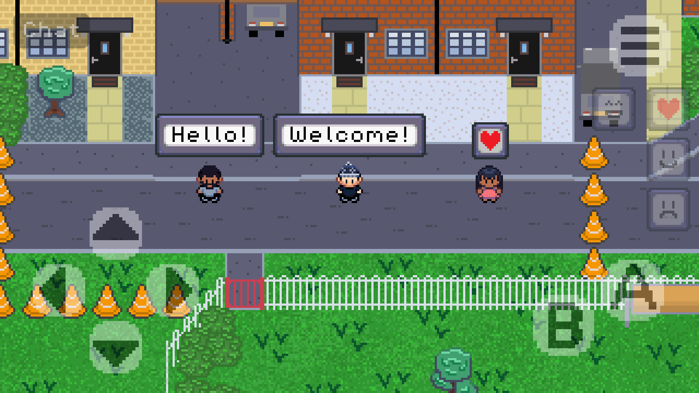
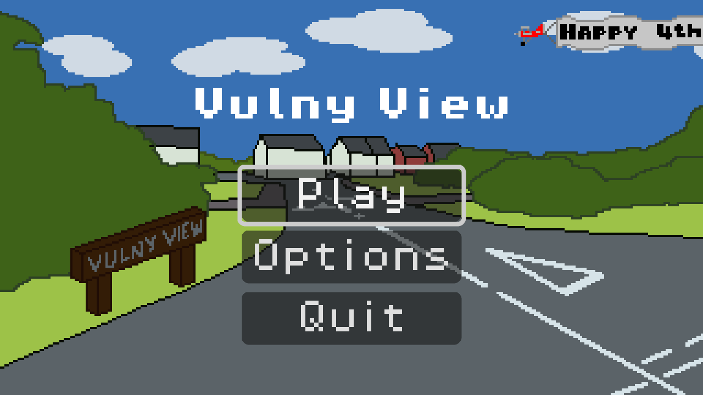
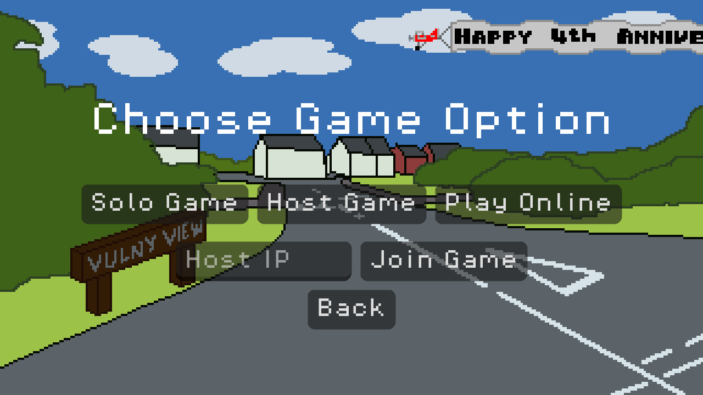
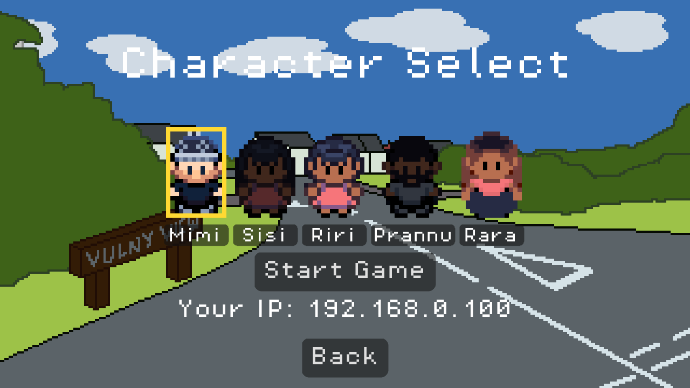

# Vulny View

## Foreword

Vulny View is a Godot project I worked on as a 4th anniversary gift for my partner. A simple game
based on our home and memories, with a Pokemon Emerald art style. Additional multiplayer and chat
system so that I could surprise her and her sister at the same time despite living in different cities.

The project was made with the assistance of Claude AI, helping with unfamiliar areas, such as multiplayer,
as well as bug fixing, cleanup and documentation.

## Overview

A top-down, grid-based pixel-art game for Android (with a single-player web version), built
with **Godot 4.7** and **GDScript**.
Pick a character, explore a small town and its houses, chat with friends and talk to the
local cats. You can play solo, host a game on your Wi-Fi, or join a dedicated server online.

## Screenshots

| Main menu | Game modes | Character lobby |
|---|---|---|
|  |  |  |

## Features

- **Grid movement:** one tile at a time, with tap-to-turn and hold-to-walk, like classic
  handheld RPGs.
- **Five playable characters**, chosen in a lobby. Characters another player has taken are
  greyed out, so no two players share one.
- **A town with house interiors**, joined by doors with fade transitions.
- **NPCs** that turn to face you when you talk to them. The NPC system supports standing
  still, wandering, patrolling a path (A* pathfinding) and looking around.
- **Dialogue** from NPCs and inspectable objects, typed out in a message box.
- **Multiplayer** for up to **5 players**:
  - **Host / Join** on the same Wi-Fi. The host's lobby shows its IP for others to type in.
  - **Play Online** joins a headless **dedicated server** (deployed on AWS EC2 with systemd).
  - **Drop-in joins:** players can join a match that has already started.
- **Emotes and chat:** four emotes (including a yippie dance) and short overhead chat bubbles that every player sees.
- **Touch controls built for phones:** a virtual-joystick D-pad and buttons that stay pinned
  to the screen edges on any aspect ratio. Keyboard controls work too.
- **Sound effects** for doors, talking to the cats and the yippie dance.
- **Options:** master, music and sound-effect volume plus fullscreen, saved between sessions.
  Open them from the main menu or from the pause menu during a game.
- **Web version:** a single-player build that runs in a browser.

## How the multiplayer works

- **Server-authoritative:** the server simulates every player and NPC; clients only send
  which direction they are holding. Emotes and chat also go through the server, which checks
  the sender, rate-limits and sanitizes messages before sending them to everyone.
- **Client-side prediction:** your own character moves instantly on your screen and is
  corrected against the server's position, so there is no input lag.
- **Interpolation:** other players and NPCs glide smoothly between network updates.
- **Load, then connect:** each device loads the world before connecting, so players who are
  already in the game appear correctly when someone joins.

Networking uses Godot's high-level multiplayer API over ENet (UDP port 8080).

## Getting started

1. Install **[Godot 4.7](https://godotengine.org/)**.
2. Open the [`vulny-view/`](vulny-view/) folder in Godot and press **F5**.
3. To try multiplayer on one PC, run two instances. Choose **Host Game** in one, then
   **Join Game** with the Host IP field left blank in the other.

| Action   | Keyboard          | Touch               |
|----------|-------------------|---------------------|
| Move     | WASD / Arrows     | D-pad (bottom-left) |
| Interact | Space / Enter / Z | A                   |
| Cancel   | Backspace         | B                   |
| Pause    | Escape            | Menu                |
| Emote    | 1 / 2 / 3 / 4     | Emote buttons       |
| Chat     | T                 | Chat (top-left)     |

## Documentation

- [`vulny-view/README.md`](vulny-view/README.md): playing guide, multiplayer setup,
  deploying the dedicated server to Linux / AWS EC2, and building for Android and the web.
- [`CLAUDE.md`](CLAUDE.md): a detailed architecture guide to the codebase.

## Credits

- Music: 'Pixeltown' by Color Parade on #Uppbeat — https://uppbeat.io/c/color-parade
  (License code: YXVNQMD9JQP5I1K2)
- Font: Pixel Operator 8 — [CC0 1.0 Universal](https://creativecommons.org/publicdomain/zero/1.0/)
